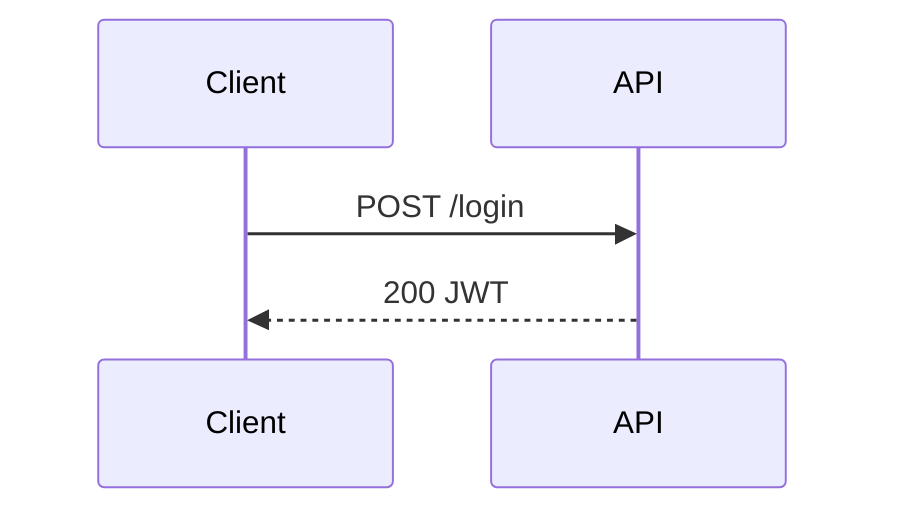

# E-Ink Review

Push content to the Boox for reading and annotation. Supports iterative rounds: the user annotates and taps "Request Update", the agent rewrites the document and calls `update_session`, and the tablet reloads automatically.

Works in OpenCode and Claude Code. Choose delivery by **available tools**, not the
agent's name: Claude channel tools when available, otherwise a background CLI watcher.
The server durably stores pending feedback so a late/reconnected watcher recovers it.

## Usage

```
/eink [file]
/eink continue [session-id]
```

- First establish the user's review goal, including when a file path is supplied.
- Send only the agreed content; an invocation is not permission to dump the conversation.
- `continue` resumes watching an already-active session (no new push).

---

## Steps for `/eink continue [session-id]`

1. If no session-id was given, find the most recent active session:
   ```bash
   eink-review list --status active
   ```
   Use the only active session if there is one. If there are several, ask which one;
   the newest session may belong to a different conversation. If none, say so.

2. Attach the background watcher below. It also recovers pending feedback already
   sent without a callback. A server session alone does not connect this conversation.

3. Recover the current markdown once from `GET /api/sessions/<id>/content` if it is
   absent from this conversation. Confirm the intended review focus if it is unknown.
   Keep the content and version for subsequent rounds rather than fetching on every note.

---

## Steps for a new push

### 1. Clarify the reading contract

Before creating a session, establish **content, purpose, and depth**. Ask only for
missing information, in one short conversational message, and wait for the answer.
Useful questions are:

- **Content:** Which topic, file, or part of the current work should go on the tablet?
- **Purpose:** What should the user assess—clarity, correctness, architecture,
  alternatives, or a decision? Are they reading for understanding or requesting edits?
- **Depth/constraints:** Quick skim or detailed explanation? Anything to include,
  exclude, preserve, or avoid changing?

A filename identifies content, not purpose. For `/eink README.md`, ask what the user
wants from the review before sending it. For “current context”, clarify which part
and why instead of exporting an arbitrary summary.

If the prompt already supplies the contract, briefly reflect it and proceed without
a redundant interview. Offer a concise, bullet-led layout as a default; ask about a
diagram only when the topic needs one. Do not make the user choose a formatting menu
before understanding their goal.

Once agreed, prepare a focused document from the supplied file or context. Preserve
the original file unless the user authorized editing it. Before sending, state the
review focus and proposed length in one sentence; ask again only if the scope changed.

### 2. Connect delivery, then announce the session

**Claude channel path:** use this only when `subscribe_session` is available and
Claude channel notifications are enabled (`--dangerously-load-development-channels server:eink-channel`).

```bash
CHANNEL_PORT=${EINK_CHANNEL_PORT:-8789}
SESSION_ID=$(eink-review --server "${EINK_SERVER_URL:-http://localhost:3333}" push --async --callback-url "http://127.0.0.1:$CHANNEL_PORT/" <file>)
echo "SESSION_ID:$SESSION_ID"
```

Immediately after getting the session ID, call the `subscribe_session` tool with it:
```
subscribe_session(session_id="<SESSION_ID>")
```

This claims the session so that webhook events are routed only to this Claude instance and not to other running instances.

**Portable path (OpenCode, or Claude Code without channel tools):**

```bash
SESSION_ID=$(eink-review --server "${EINK_SERVER_URL:-http://localhost:3333}" push --async <file>)
# Launch the next command with the harness's background tool, using a unique ready file:
python3 <skill-base>/scripts/watch-feedback.py <session-id> --timeout 30 --ready-file <unique-ready-file>
# Then confirm the actual WebSocket handshake with a foreground command:
python3 <skill-base>/scripts/watch-feedback.py --wait-ready <unique-ready-file>
```

Run push in the foreground to obtain the ID, then launch the observer command through
the harness's **background shell tool**. In OpenCode use `shell(background=true)`;
in Claude Code use Bash's background-job option. The job's completion notification
is how feedback reaches this conversation. `--timeout` is **minutes**. Keep stderr
visible for connection failures. If background jobs are unavailable, tell the user
automatic delivery is unavailable and offer a foreground watch.

Use a fresh ready-file path for every observer (a temporary directory plus session
and round is sufficient). The ready-file check is a bounded local handshake wait,
not network polling. `state=ready` confirms a live connection; `state=event` means
feedback already arrived—handle that completion and arm the next observer.

Announce readiness only after subscription succeeds or the handshake is confirmed.
If channel subscription fails, attach the portable watcher to the same session.
Include the session ID and delivery path. If the watcher exits, report it and reattach;
do not claim to be listening without a live subscription/job.

---

## When a channel event arrives

Channel events arrive as:

```xml
<channel source="eink-channel" event_type="..." session_id="...">
{ ...JSON body... }
</channel>
```

Match `session_id` to the active session. Ignore events for other sessions.

### Case: `event_type="annotation_result"`

JSON body structure:

```json
{
  "type": "annotation_result",
  "version": 2,
  "annotations": [
    {
      "recognized_text": "expand this section",
      "anchor": {
        "type": "proximity",
        "elements": [
          { "section_id": "section-background", "tag": "h2", "text": "Background" }
        ]
      }
    }
  ]
}
```

Key fields:
- `annotations[].recognized_text` — OCR'd handwriting
- `annotations[].anchor.elements[]` — nearby document elements (use to locate sections)
- `anchor: null` — unanchored; treat as general comment

Use `feedback_id` to distinguish a new request from a replay after reconnect.
Annotations are the current visible ink, which can include retained earlier notes;
apply only feedback not already incorporated.

### Snappy observer loop

1. Acknowledge the received note in one sentence. With the portable path, **arm the
   next observer immediately**, before drafting, using `--after-feedback <feedback_id>`
   and a fresh ready file. Only one observer should be waiting for this conversation's
   session. Claude channel subscriptions stay attached without rearming.
2. Use the cached markdown and compact event's anchor/text to make the requested
   revision. An obvious note such as “say more” needs a focused expansion, not another
   intake questionnaire. Ask only when the annotation's intent or target is ambiguous.
3. Send the update with its version guard and feedback ID, then give a short completion
   message. Keep the reader's loop focused on the document: repository work, deployment,
   broad research, and unrelated tests require separate authorization and should not
   delay a straightforward revision.

Both delivery paths omit raw stroke/pressure arrays from agent context. Fetch the
full `/feedback` or `/result` only when handwriting is unclear or visual evidence is
needed. Normal revisions should not require extra screenshots, preference dumps, or
status requests. The transport is event-driven, not periodic network polling.

If a newer feedback ID arrives while drafting, reconcile that latest request before
updating; a rejected stale rewrite is not a reason to discard the newer annotation.

Rewrite the document applying the feedback. The native client asks the server to
match old/new text and reposition retained ink. Positional section IDs alone are
not stable identity. Deleted or ambiguous targets are archived rather than guessed.

Then call the `update_session` tool:
```
update_session(session_id="<id>", content="<full updated markdown>", expected_version=<version>, feedback_id="<feedback_id>", consumed_annotations=[<zero-based indices incorporated>])
```

`consumed_annotations` are indices in this event's `annotations` array, **not**
bind-group IDs. Leave unaddressed notes out so they follow the remaining text.
The tablet removes consumed strokes, including ordinary unbound handwriting.

Without `update_session`, PUT the same JSON fields to
`$EINK_SERVER_URL/api/sessions/<id>/content` (default `http://localhost:3333`).
409 means stale version: fetch `/api/sessions/<id>/feedback` and reconcile before retrying.
If its status is terminal, report the closed review instead of attempting another rewrite.
Only a matching `feedback_id` acknowledges pending feedback; ordinary content edits
do not silently discard it.

The portable observer already rearmed at the start of this round remains attached
after the rewrite. If it ended meanwhile, reconnect and confirm its handshake before
saying the next round is ready. Each background job returns one event, not a permanent
subscription. The tablet reloads automatically.

To stop a portable observer, terminate only the observer PID in its own ready-file
receipt (or cancel its harness job). It cleans up its CLI child. Never kill every
`eink-review` process: other conversations can have their own reviews.

### Case: `event_type="submitted"`

JSON is `SessionResultResponse`. Key fields:
- Compact events include `annotation_image_count`; fetch `/api/sessions/<id>/result`
  for image references/full evidence when needed. Do not assume image references are base64.
- `verdict` — `LGTM` or `CHANGES`
- `annotations[]` — final annotation set

Summarize all feedback and continue the conversation. Stop any rearmed observer;
there is no next round after submission, cancellation, or expiry.

### Case: `event_type="cancelled"`

Tell the user the session was cancelled.

---

## When the watch fallback returns (continue sessions)

Output starts with `EVENT:ANNOTATION_RESULT` or `EVENT:SUBMITTED` — same JSON structure as above.
Handle identically: rewrite doc → `update_session` for annotation_result, summarize for submitted.

### Case: connection refused

If `eink-review push` fails: `systemctl --user start eink-serve`

---

## Authoring Review Documents

**Be minimalistic.** The reader is on an e-ink tablet — they want to scan, not read essays.

Structure every document like this:
1. **Brief overview** — 1–3 sentences or bullets stating what this is and why it matters.
2. **Body** — short bulleted points, not paragraphs. Break prose into bullets whenever possible.
3. **At most one diagram per document**, and only when structure genuinely cannot be expressed in bullets.

Hard limits:
- Prefer bullets over prose. If a paragraph is more than ~3 lines, split it into bullets.
- **Maximum one diagram per document.** Two only if they show fundamentally different things (e.g. an architecture graph and a state machine). Never use a diagram as decoration.
- Skip the diagram entirely if a bulleted list communicates the same information.
- No "executive summary" + "summary" + "TL;DR" stacking — one overview, then content.

The renderer supports normal Markdown plus the diagram blocks below. Use them sparingly:

- `mermaid` for flowcharts, sequence diagrams, state machines — when ordering or interaction matters
- `mindmap` for plans or decompositions — when a flat bulleted list would obscure hierarchy
- `graph` for architecture maps — when relationships between components are the point

If you find yourself reaching for a second diagram, replace it with bullets.

### Color semantics — use consistently

| Color | Meaning |
|-------|---------|
| `red` | Problem, blocker, broken, needs attention |
| `green` | Good, done, healthy, approved |
| `amber` | Warning, uncertain, in progress |
| `blue` | Information, reference, external |
| `purple` | Key decision or design point |
| `slate` | Deprioritized, deferred, secondary |

### `graph` example

```graph
layout:
  algorithm: layered
  direction: RIGHT
nodes:
  - id: user
    label: User
    kind: client
    color: blue
  - id: api
    label: API Server
    kind: backend
    color: green
edges:
  - from: user
    to: api
    label: HTTPS
```

### `mindmap` example

```mindmap
root: Fix Auth Bug
index: true
nodes:
  - id: root
    label: Root Cause
    color: amber
    children:
      - label: Token expiry misconfigured
        color: red
```

### `mermaid` example



### Mermaid gotchas

**Avoid reserved keywords as participant aliases in `sequenceDiagram`.** Mermaid's
parser is case-insensitive for keywords, so `AND`, `AS`, `END`, `LOOP`, `ALT`,
`OPT`, `PAR`, `NOTE`, `RECT`, `LINK`, `BOX` as short aliases silently break the
parser with an `Expecting 'SPACE', 'NEWLINE', ... got 'and'`-style error. The
diagram then falls back to a parse-error block showing the message and source.

Safe short aliases: `CLI`, `SRV`, `TAB`, `AGT`, `DB`, `API`, `UI`, `WEB`, `SVC`.

If a mermaid block shows a parse error, read the message — it points at the
exact token that clashed. To reproduce locally, open `/eink-webview` and call
`mermaid.render('id', source)` from the Chrome DevTools console.

## Guidance

- Push to the Boox whenever the user needs to review a plan, architecture, or diff.
- Lead with a 1–3 sentence/bullet overview so the reader gets the gist without scrolling.
- Use bullets, not paragraphs. Use at most one diagram per document.
- When you do use a diagram, color every node intentionally — but ask yourself first whether bullets would suffice.
- The `eink-serve` systemd service must be running. Connection refused → `systemctl --user start eink-serve`.
- Channel notifications are Claude-specific; the portable background watcher works in both harnesses.
- You are not blocked while waiting; wait for the harness's background completion notification.
- After all rounds complete, summarize all feedback and continue informed by it.
